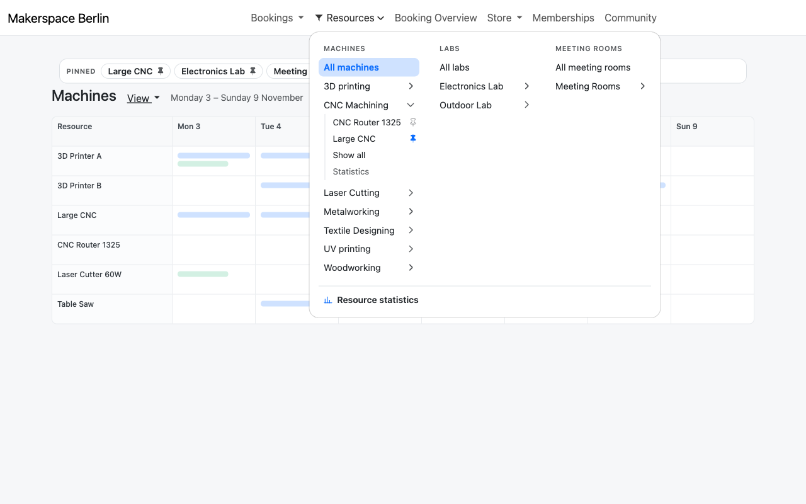
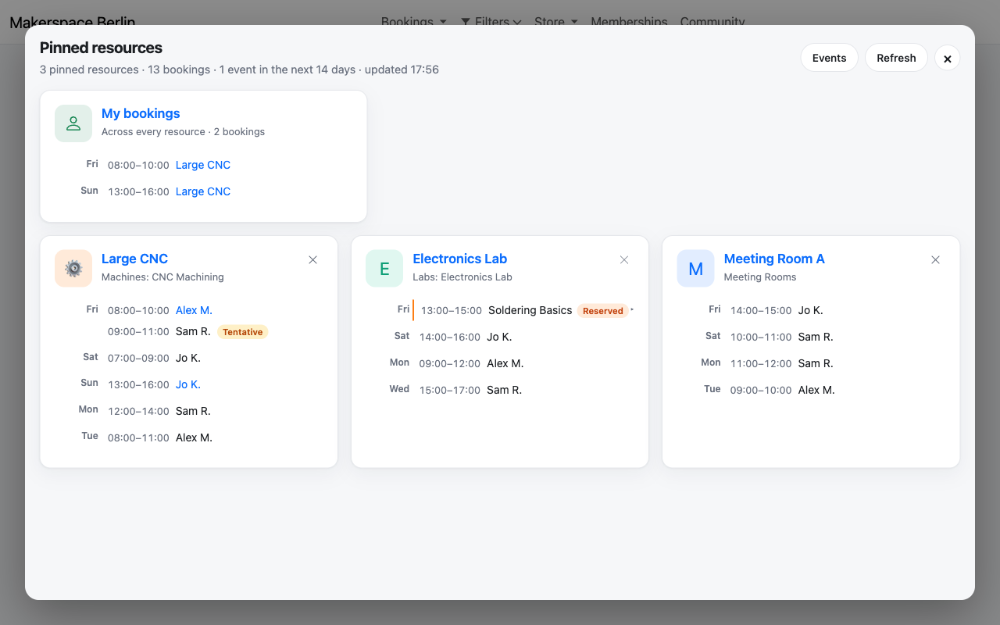
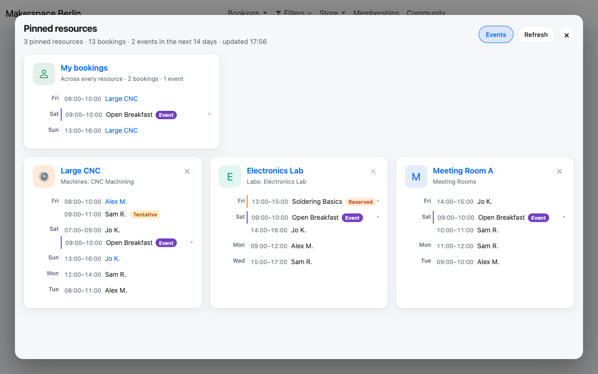
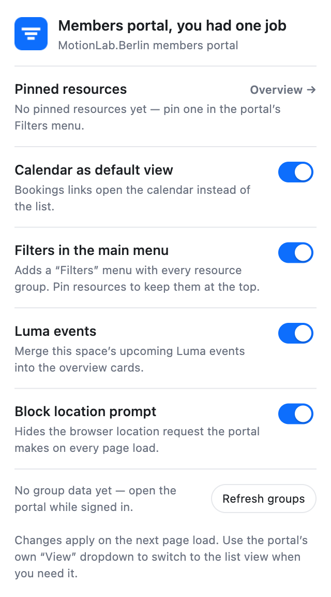

# Members portal, you had one job

A small Safari / Chrome extension that improves the MotionLab.Berlin Nexudus
members portal (<https://members.motionlab.berlin/motionlabberlin>). Every
Nexudus space lives on its own domain, so the build is tied to one portal; see
[Using it on another space](#using-it-on-another-space) to retarget it. See
[CHANGELOG.md](CHANGELOG.md) for the version history.

It does six things:

1. **Resource filters in the main menu.** A new **Filters** item next to
   *Bookings* lists every bookable resource type and its resource groups
   (Machines › CNC Machining, Labs › Outdoor Lab, …). One click jumps straight
   to that group instead of *Bookings → Machines → Filters → Group → Close*.
   Below 1200 px the portal swaps the top navigation for its bottom dock, so the
   extension adds a **Filters** button there that opens the same list as a
   bottom sheet.
2. **Pinnable resources.** Expand a group in the **Filters** menu and press the
   pin icon next to a resource (for example *OLSK Large CNC*). Pinned resources
   appear at the top of the menu; clicking one opens the calendar with **only
   that resource**, so there is no horizontal scrolling through every machine of
   the type. A *Pinned* banner above the calendar links back to that resource's
   group, so *Show all CNC Machining* keeps the category in view instead of
   jumping to the first resource of the whole type.
3. **Pinned resources overview.** An overview shows every pinned resource as a
   card with its bookings and workshop reservations for the next 14 days,
   grouped by day like the widgets in the Always in Motion dashboard. A
   **My bookings** card above them lists only your own bookings across every
   resource. Your booking titles link to their portal booking page, and the
   **My bookings** title links to the portal's My Bookings page. Workshops
   appear with a *Reserved* badge and can be expanded for details. Open it from
   the **Overview →** button at the top of the Filters menu, which shows it in
   an overlay inside the portal (Esc, the × button or a click on the backdrop
   closes it), with **Alt+O** anywhere on the portal page; the toolbar popup
   opens the same overview as a standalone page in a new tab. Each card's title
   links to the single-resource calendar, and its × button unpins the resource.
4. **Calendar by default.** Bookings links open the calendar view instead of the
   list view. Picking *List* in the portal's own *View* dropdown still works and
   is remembered for the tab.
5. **No location prompt.** The portal asks for the browser location on every
   page load. Safari only remembers a denial for a day, so the dialog returns
   each visit; the extension hides `navigator.geolocation` from the page, which
   makes the portal skip the request instead of prompting. The popup's *Block
   location prompt* toggle turns this off.
6. **Luma events.** With the *Luma events* toggle on, the pinned overview also
   merges MotionLab.Berlin's upcoming Luma events into every card and the
   **My bookings** card, with a purple *Event* badge. Expanding a row loads its
   description and links to the event on Luma, like the Django dashboard. The
   **Events** button in the overview header toggles the same setting as the
   popup.

The four toggles live in the toolbar popup; pins are managed from the menu
itself. The overview page uses the portal session the content script mirrors
into extension storage, so open the portal once while signed in.

```
Bookings ▾   Filters ▾   Store ▾   Memberships   Community
              ┌──────────────────────────────────────────────┐
              │ [ Overview → ]                               │
              │ PINNED                                       │
              │ [ OLSK Large CNC (pin) ] [ E-Lab (pin) ]      │
              │ MACHINES        LABS           MEETING ROOMS │
              │ All machines    All labs       All meeting…  │
              │ 3D printing  ›  E-Lab        › Meeting Rooms │
              │ CNC Machining › Metal Lab    ›               │
              │ Laser Cutting › Outdoor Lab  ›               │
              │ …               …                            │
              └──────────────────────────────────────────────┘
```

## Screenshots

Shot on an invented space: the member, machine and booking names are made up.
`tests/screenshots.html` renders the same pages with stubbed extension APIs, so
the images can be regenerated without signing in.

**The Filters menu** — every resource group, one click from the calendar:



**The pinned resources overview** — your own bookings, then one card per pinned
resource:



**With Luma events merged in** — the space's public events carry an *Event*
badge:



**The toolbar popup** — four toggles, the pin count and the overview link:



## Install

### Chrome / Edge / Brave

```bash
npm run build          # produces dist/chrome and dist/members-portal-you-had-one-job.zip
```

Then open `chrome://extensions`, enable *Developer mode*, choose
**Load unpacked** and select `dist/chrome` (or the `src` folder directly while
developing). Reload the portal tab afterwards.

You can skip the local build: every `v*` tag runs the tests, builds on Linux and
attaches that zip to a
[release](https://github.com/tiktuk/members-portal-you-had-one-job/releases). Unpacked
installs never update themselves, so repeat the last step for each release.

### Safari

Safari needs a signed app wrapper; Apple's converter generates it:

```bash
npm run build          # also runs safari-web-extension-converter (needs Xcode)
open "dist/safari/Members portal, you had one job/Members portal, you had one job.xcodeproj"
```

In Xcode run the **Members portal, you had one job (macOS)** scheme once. Then in Safari:
*Settings → Extensions → Members portal, you had one job* → enable it and allow it on
`members.motionlab.berlin`. The iOS project in the same Xcode project works the
same way if you want it on a phone.

## Using it on another space

Every Nexudus space lives on its own domain, so the manifest can only name one:
`members.motionlab.berlin` in `content_scripts.matches`, and
`https://motionlabberlin.spaces.nexudus.com/*` in `host_permissions` for the
space's API. The Web Store build stops there, because the permissions that a
"connect any portal" button needs — `scripting`, an optional `https://*/*` host
permission and a wildcard `https://*.spaces.nexudus.com/*` — are what the store
flags as overly broad and reviews slowly.

Another space forks this repository and changes four things, then builds its own
package:

| Where | What |
|-------|------|
| `src/lib/config.js` | `portal.origin` and `portal.webAddress` |
| `src/manifest.json` | `content_scripts[0].matches` and the `host_permissions` entry for the API |
| `src/lib/config.js` | `luma.source`, if the space has a public Luma calendar, and `geo`/`nav` defaults if it wants them |
| `src/manifest.json` | `web_accessible_resources[0].matches`, to the same portal origin |

`npm test` checks that the two manifest values and the config agree, so a
half-finished retarget fails before the build does.

The earlier implementation that let the popup add portals at runtime is kept on
the [`runtime-portals`](../../tree/runtime-portals) branch.

## Configuration

Everything tunable lives in `src/lib/config.js`. The popup's toggles are stored
in `chrome.storage.local`; `geo.blockPrompt` and `luma.enabled` below only seed
the *Block location prompt* and *Luma events* toggles.

| Key | Meaning |
| --- | --- |
| `nav.label` | Text of the injected menu item (default `Filters`). |
| `nav.stripGroupPrefix` | Show `3D printing` instead of `Machines: 3D printing`. |
| `nav.hideEmptyTypes` | Hide resource types that have no groups. |
| `defaultView` | View used by the injected links (`calendar`). |
| `geo.blockPrompt` | Default for the popup's *Block location prompt* toggle: hide `navigator.geolocation` so the portal stops asking for the location (`true`). |
| `resourceTypeOrder` | Column order of the menu. |
| `nav.resourceParam` | Query parameter used for single-resource links (`onejob-resource`). |
| `overview.shortcut` | Key combo that opens the overview overlay from the portal (`alt+o`). Matched on the physical key, so it works with Option layouts that type `ø`. |
| `luma.source` | Public Luma user (`usr-…`) or calendar (`cal-…`) API ID, or a luma.com URL containing one (MotionLab.Berlin's user by default). Mirrors the Django app's `Space.luma_source`. |
| `luma.enabled` | Default for the *Luma events* switch (popup and overview header) (`true`). |
| `cache.groupsTtlMs` | How long resource groups are cached (6 h). |
| `portal.origin` / `content_scripts.matches` | The built-in portal. Change both, plus `portal.webAddress` and the manifest's `host_permissions` entry, to retarget the build (see [Using it on another space](#using-it-on-another-space)). |

The menu is built from the portal's own navigation (which resource types it
offers) plus `GET /api/public/resources/published/details` for the group and
resource names. Pins are stored in `chrome.storage.local` under `onejob:pins`.
The portal session used by the overview page is mirrored into `onejob:session`
(`{ accessToken, webAddress, origin, expiresAt, savedAt }`) whenever the portal loads
with a live `AUTH_TOKEN` cookie.

## How it works

The members portal is a React SPA served from `members.motionlab.berlin`; each
space's API lives on its own subdomain, `https://<webAddress>.spaces.nexudus.com`
(the generic `spaces.nexudus.com` host returns 500 for public endpoints).

- Booking routes are `/<webAddress>/bookings/<type>/<view>` where `view` is
  `list`, `calendar`, `floorplan` or `map`. The resource type is a slug such as
  `machines`, `labs` or `meeting-rooms`.
- The list/calendar views filter their resources by query parameters, notably
  `group=<exact GroupName>` and `type=<SystemResourceType>`. There is no
  resource-level query parameter, so the extension implements one itself.
- The SPA stores its session in a readable `AUTH_TOKEN` cookie (JSON with
  `access_token`), which is what lets the extension fetch resource groups
  without a background service worker.

The pinned overview page fetches `/en/bookings/fullCalendarBookings` (bookings)
and `/en/bookings/fullCalendarEvents` (workshops and other resource events) from
the space host with that same bearer token. Both payloads contain every record
in the range with a `resourceId`, so the page keeps the pinned resources and
groups the next 14 days into day sections; events get a *Reserved* badge and an
expandable description.

Both feeds return UTC instants, despite the `ignoreTimezone: true` flag on the
events. The page converts them to the browser's timezone, matching the portal
calendar and the web app: an `08:00Z` booking shows at 09:00 in Berlin, and a
`10:00Z` workshop at 11:00. The CLI uses the REST
`/api/bookings/fullCalendarEvents` endpoint, which returns a different
wall-clock value (`11:00Z`) and prints it without conversion, so its workshop
time is an hour early. The page refreshes every minute while it is visible and
can unpin resources without leaving the page.

The **My bookings** card fetches `/api/public/bookings/my` with the same token
and date window, follows `HasNextPage`, skips cancelled bookings, and shows the
resource name for each row. That endpoint returns naive local `FromTime`/
`ToTime` values, so they are used as-is (no timezone conversion). It loads even
when nothing is pinned.

Your own booking titles link to
`/<webAddress>/public/bookings/edit?id=…&resource_id=…` (the portal fills in the
rest), and the **My bookings** title links to
`/<webAddress>/user/activity/bookings`. Other members' bookings are shown as
plain text: the portal's edit page only opens bookings that belong to the
signed-in member.

Luma events come from the public web API the luma.com site itself uses
(`/user/profile/events-hosting` for a `usr-…` source, `/calendar/get-items` for
a `cal-…` one), so no API key is needed. Those endpoints only allow
`https://luma.com` as a CORS origin, and content scripts are subject to CORS,
so `src/background.js` fetches them in the service worker where the
`https://api.luma.com/*` host permission applies. The list is cached for five
minutes and merged into every card (and **My bookings**) like the Django
dashboard, capped at ten events per card. Expanding a row lazily calls
`/event/get` (cached for an hour) and flattens Luma's ProseMirror description to
plain text, mirroring the web app's HTMX endpoint. Luma timestamps are UTC
instants, so they go through the same browser-timezone conversion as the portal
feeds.

The overview markup, fetching and styles live in `src/lib/overview-view.js` and
`src/overview.css`, which are shared by the standalone page and the in-portal
overlay. The overlay mounts the same module into a shadow root, so its generic
class names (`.card`, `.notice`, `.button`) cannot collide with the portal's
Bootstrap styles in either direction.

Three scripts do the work:

- `src/content.js` (isolated world) rewrites the initial `list` URL to
  `calendar` **before the app boots**, injects the menu, caches groups and
  resources, and stores pins.
- `src/page.js` (page world) patches `history.pushState`/`replaceState` so
  client-side navigation also lands on the calendar, and remembers an explicit
  *List* choice from the portal's *View* dropdown. It also hides
  `navigator.geolocation` before the app boots (see above).
- `src/background.js` (service worker) proxies the Luma API for the overview,
  since Luma's CORS policy blocks direct calls from the portal origin.

A pinned link looks like
`/motionlabberlin/bookings/machines/calendar?group=…&onejob-resource=1415309496`.
The portal ignores the extra parameter, so `page.js` narrows the
`/api/public/resources/published/details` response down to that id before the
calendar renders, and makes the portal's filters no-ops while pinned (only the
calendar's `start`, `end` and `view` query keys survive).
The id is also mirrored into `sessionStorage` because the portal removes unknown
query parameters when it normalises the URL. Leaving the pinned view — a
different type, the portal's *View* dropdown, or any normal calendar/list link
(including the portal's own *Bookings* menu) — clears the marker and triggers a
full navigation, so the portal's cached, filtered resource list is reset.
Reloading a pinned view keeps it.
With a single resource the portal's Previous/Next buttons (which scroll the
resource grid sideways) have nothing to scroll, so `page.js` makes them step the
date range by the visible day count instead.

Because the redirect happens on the URL and only the resources payload is
filtered, no React internals are touched; the portal's own links, filters and
view picker keep working.

## Development

```bash
npm test                       # node --test (URL logic, menu model, overview, Luma, manifest, popup)
python3 scripts/make-icons.py  # regenerate icons
npm run build                  # dist/chrome, zip, Safari Xcode project
```

`tests/fixture.html` is a harness that mirrors the portal navigation and stubs
the extension APIs, the resources endpoint and the overview endpoints, so the
menu and the overview overlay can be inspected without signing in:

```bash
python3 -m http.server 8765    # from this folder
open http://localhost:8765/tests/fixture.html
```

### Troubleshooting

- **Nothing happens on another space** — the build is tied to one portal (see
  [Using it on another space](#using-it-on-another-space)). The content script
  only runs on the origin in `content_scripts.matches`.
- **Menu missing** — sign in to the portal first (the extension needs the
  session cookie to read group names), then reload. The popup's group line shows
  what is cached; *Refresh groups* forces a re-fetch.
- **Still on the list view** — the extension remembers an explicit *List* choice
  for the tab; pick *Calendar* in the portal's *View* dropdown to reset it.
- **Only one resource is shown** — a pinned resource is active. Use *Show all
  …* in the banner above the calendar, or unpin it in the **Filters** menu.
- **Overview says “Connect to the members portal”** — the extension has no
  portal session yet. Open the portal while signed in (the content script
  stores the token), then refresh the overview page. If it says the session
  expired, open the portal once to renew it.
- **Luma events missing** — check the popup's *Luma events* toggle. If it is
  on and the overview shows a warning, Luma's public API failed or changed;
  verify `luma.source` in `config.js`.
- **Changes from the popup** apply on the next page load.
- If Nexudus changes the markup, `src/content.js` selectors
  (`nav.navbar ul.navbar-nav`, `#resourceViewDropdown`) and `config.js` are the
  only places to adjust.
